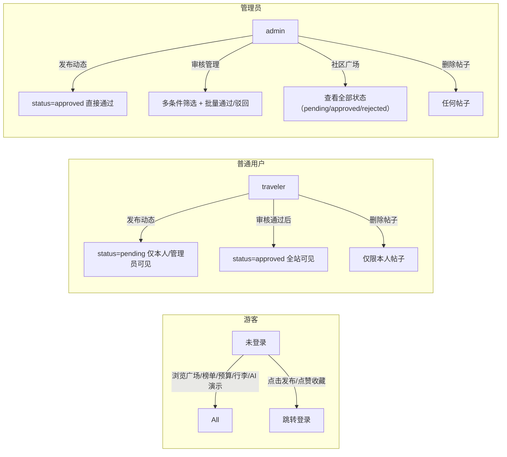

# 🌏 智能旅游规划与预算管理系统

> 基于 **Vue 3 + Spring Boot + DeepSeek-V3** 的全栈智能旅游应用，核心能力：AI 行程生成、AI 行李清单、AI 预算建议、AI POI 推荐、AI 旅游问答（SSE 流式）、社区旅友空间（管理员审核制）、智能榜单排行、预算可视化与账单追踪。

---

## 🔗 项目仓库

- **Gitee**: https://gitee.com/hyl030514/smart-travel-plan-budget

---

## ✨ 核心特性

| # | 特性 | 说明 |
|---|------|------|
| 1 | 🧠 **DeepSeek AI 集成** | 路线生成、行李清单、预算建议、POI 推荐、旅游问答，全部调用硅基流动的 DeepSeek-V3 |
| 2 | 💾 **AI 结果自动落库** | 每次 AI 生成成功即按当前用户归属写入 MySQL（trips / chat_messages / packs / expense_plans / poi_cache），无需手动保存 |
| 3 | 🔐 **JWT 鉴权 + 角色权限** | 管理员 / 普通用户双角色；社区内容管理员审核制，普通用户发布后进入待审核队列 |
| 4 | 🗺️ **高德地图预留** | AMap JS API 2.0 按配置按需注入（Key 从环境变量读取），支持路线规划、POI 搜索、实时定位 |
| 5 | 💰 **预算可视化** | 圆形进度环 + 分类统计 + 账单 CRUD + 历史预算方案 |
| 6 | 👥 **旅友空间** | 瀑布流两列布局 · 骨架屏加载 · 社区广场 / 我的动态切换 · 点赞收藏 · 图片瀑布流 |
| 7 | 🛡️ **管理员审核后台** | 多条件筛选 + 批量通过/驳回 + 精准内容管控 |
| 8 | 🏆 **榜单排行** | 黑榜 / 红榜 / 避雷榜，按城市分类 |

---

## 🖥️ 功能演示

### 1. 登录页


内置演示账号一键登录：
- 🛡️ **管理员**：`admin / admin123`（发布即通过、可审核他人内容）
- ✈️ **普通用户**：`traveler / travel123`（发布需管理员审核）

### 2. 个人中心


查看个人资料、旅行统计（行程数 / 收藏数 / 预算使用）、快捷入口。

### 3. 行程规划（AI 生成 + 自动保存）


输入目的地、天数、偏好，AI 一次生成 2~3 套完整多日路线，每套自动落库并返回 `tripId`。

### 4. AI 智能问答（SSE 流式）


基于 SSE 流式通信，按 `sessionKey` 自动归组对话，每轮 user + assistant 消息写入 `chat_sessions / chat_messages`。

### 5. 旅友空间（社区）


- 社区广场：所有已审核通过的公开动态
- 我的动态：自己的帖子全部可见（含待审核 / 已驳回）
- 管理员入口：带待审核角标，一键进入审核后台

### 6. 预算支出


预算设置 → 花销概览（渐变进度环）→ 分类统计 → 账单记录（CRUD）→ 历史预算方案。

### 7. 行李清单（AI 生成 + AI 校验）


按目的地 / 天数 / 出行方式生成行李清单，支持 AI 检查缺失、标记已准备、分类汇总。

### 8. 榜单排行


黑榜（避雷）/ 红榜（好评）/ 特色榜单，按城市切换，每张卡片配有真实实拍图。

### 9. 管理员审核后台


多条件筛选（城市 / 类型 / 状态 / 时间 / 关键词）、批量通过 / 批量删除 / 单条审核。

---

## 🏗️ 系统架构


### 数据流：AI 生成 → 自动落库

```
用户点击「生成路线」
    ↓
前端 POST /api/travel/routes/generate（带 Bearer Token）
    ↓
RoutePlanController 注入 @CurrentUser LoginUser(userId)
    ↓
RoutePlanService → LLMutils.chat(prompt) → DeepSeek-V3 返回 JSON
    ↓
TravelPersistenceService.saveRoutePlans(userId, req, vo)
    ├── 每一套路线 → INSERT trips
    ├── 每天行程   → INSERT trip_day_plans
    └── 每个景点   → INSERT trip_points
    ↓
返回 MultiRouteVO（每套路线带 tripId）
    ↓
前端 routeList[i].tripId 可用于后续"保存 / 查看详情"
```

SSE 对话、预算建议、行李清单、POI 推荐同理，均在 AI 返回后立即按用户归属落库。

---

## 🛠️ 技术栈

| 层 | 技术 | 版本 |
|----|------|------|
| 前端框架 | Vue 3 + `<script setup>` + Composition API | 3.x |
| 前端构建 | Vite | 8.x |
| UI 组件 | Vant 4 | 4.x |
| 状态管理 | Pinia | 2.x |
| 路由 | Vue Router | 4.x |
| HTTP 客户端 | Axios + 拦截器（JWT 自动注入） | 1.x |
| 地图 | 高德地图 JS API 2.0（按需注入） | 2.0 |
| 后端框架 | Spring Boot | 4.0.6 |
| ORM | MyBatis-Plus | 3.5.7 |
| 鉴权 | JWT（jjwt）+ 拦截器 + 参数解析器 | - |
| 大模型 | DeepSeek-V3（经硅基流动中转） | deepseek-ai/DeepSeek-V3 |
| 数据库 | MySQL | 8.x |
| JSON 处理 | Jackson | 2.x |
| 其他 | Lombok、HikariCP 连接池 | - |

---

## 🚀 快速启动

### 环境要求

- JDK 17+
- Node.js 18+
- MySQL 8.0+（账号需有 CREATE / INSERT / UPDATE 权限）
- Maven（或使用项目内 `./mvnw`）

### 步骤 1：克隆仓库

```bash
git clone https://gitee.com/hyl030514/smart-travel-plan-budget.git
cd smart-travel-plan-budget
```

### 步骤 2：初始化数据库

```bash
mysql -uroot -p < travel_h5_schema.sql
```

脚本会自动创建 `travel_h5` 数据库、14 张表、种子账号与种子数据。种子账号：

| 用户名 | 密码 | 角色 | 说明 |
|--------|------|------|------|
| admin | admin123 | 管理员 | 发布即通过，可审核他人内容 |
| traveler | travel123 | 普通用户 | 发布需管理员审核 |

### 步骤 3：配置后端

编辑 `travel-java-server/src/main/resources/application.yml`（或设置环境变量）：

```yaml
spring:
  datasource:
    url: jdbc:mysql://localhost:3306/travel_h5?useSSL=false&allowPublicKeyRetrieval=true&serverTimezone=Asia/Shanghai
    username: root
    password: 你的密码

llm:
  api-key: sk-xxxxx            # 硅基流动 API Key
  base-url: https://api.siliconflow.cn/v1
  model: deepseek-ai/DeepSeek-V3

jwt:
  secret: 你的JWT密钥
```

启动后端（端口 3200）：

```bash
cd travel-java-server
./mvnw -DskipTests spring-boot:run
```

### 步骤 4：配置并启动前端

```bash
cd travel-h5-java
copy .env.example .env.local
# 编辑 .env.local，填入你的高德 Key（可选）
# VITE_AMAP_KEY=你的高德Key
# VITE_AMAP_SECURITY_CODE=你的安全密钥
npm install
npm run dev
```

访问 http://localhost:5173 即可。前端通过 Vite 代理 `/api → http://localhost:3200` 与后端通信。

---

## 📦 项目结构

```
smart-travel-plan-budget/
├── travel-h5-java/                    # 前端（Vue 3 + Vite）
│   ├── src/
│   │   ├── api/index.js              # 统一 API 层（对接后端接口约定）
│   │   ├── components/
│   │   │   ├── community/            # 社区组件（Card / Filter / Sidebar / Hero / PublishModal）
│   │   │   └── planner/              # 行程规划组件（RouteTab / MapPanel / PointCard）
│   │   ├── store/                    # Pinia Store（auth / community / trip / budget / favorite）
│   │   ├── utils/                    # API 封装（routeApi / poiApi / budgetApi / packingApi / amapApi / request）
│   │   ├── views/                    # 页面（Login / ProfileHome / TripPlanner / Chat / CommunitySpace / Budget / PackingList / Ranking / AdminReview）
│   │   └── router/index.js           # 路由 + 守卫（adminOnly / authOnly）
│   ├── .env.example                  # 环境变量模板
│   ├── vite.config.js                # Vite 配置（代理 / 端口 / 别名）
│   └── package.json
│
├── travel-java-server/                # 后端（Spring Boot + MyBatis-Plus）
│   └── src/main/java/org/example/traveljavaserver/
│       ├── controller/               # 10 个 REST 控制器（Auth / Post / Travel / Route / Budget / Packing / Poi / Ranking / Trip）
│       ├── service/                  # 业务服务（TravelService / RoutePlanService / BudgetService / PackingService / PoiService / TravelPersistenceService）
│       ├── entity/                   # 数据库实体（User / CommunityPost / Trip / TripDayPlan / TripPoint / Pack / PackCategory / PackItem / ExpensePlan / ChatSession / ChatMessage / PoiCache / RankItem / Favorite / Comment）
│       ├── mapper/                   # MyBatis-Plus Mapper
│       ├── dto/                      # 请求 DTO（ChatRequestDTO / RouteRequestDTO / BudgetAdviceDTO / PackingRequestDTO / PoiRequestDTO）
│       ├── vo/                       # 响应 VO（MultiRouteVO / PackingListVO / BudgetAdviceVO / PoiRecommendVO / TravelRecommendVO / StreamDoneVO / StreamErrorVO）
│       ├── auth/                     # JWT 鉴权（JwtAuthInterceptor / LoginUserArgumentResolver / LoginUser / CurrentUser）
│       ├── config/                   # WebConfig（拦截器注册）/ CorsConfig / MybatisPlusConfig
│       └── utils/                    # LLMutils（DeepSeek 调用）/ JsonExtractUtil / JwtUtil
│
├── travel_h5_schema.sql              # MySQL 初始化脚本（14 张表 + 种子数据 + DDL 注释）
├── rank_seeds.sql                    # 榜单种子数据
├── seed_data.sql                     # 补充种子数据
├── gen_rank_seeds.mjs                # 榜单种子生成脚本
├── docs/screenshots/                  # README 配图（10 张真实截图）
└── .gitignore
```

---

## 🗄️ 数据库设计

共 **14 张表**，按模块分组：

### 用户 & 鉴权

| 表 | 说明 | 关键字段 |
|----|------|----------|
| `t_user` | 用户 | `username`(unique), `password`(MD5), `role`(admin/user), `status`(1=正常) |

### 社区旅友空间（审核制）

| 表 | 说明 | 关键字段 |
|----|------|----------|
| `t_post` | 帖子 | `author_id`, `status`(pending/approved/rejected), `images`(JSON), `perm`(public/private) |
| `t_comment` | 评论 | `post_id`, `user_id`, `content` |
| `t_favorite` | 收藏 | `user_id`, `target_type`, `target_id` |

### AI 自动落库（生成即保存）

| 表 | 说明 | 关键字段 |
|----|------|----------|
| `chat_session` | AI 对话会话 | `user_id`, `session_key`(unique), `title` |
| `chat_message` | AI 对话消息 | `session_id`, `role`(user/assistant), `content`(TEXT) |
| `poi_cache` | POI 推荐缓存 | `user_id`, `destination`, `payload`(JSON) |
| `t_trip` | 行程方案 | `user_id`, `source`(ai/manual), `days`, `budget` |
| `trip_day_plan` | 每日行程 | `trip_id`, `day_num`, `theme` |
| `trip_point` | 行程景点 | `day_plan_id`, `name`, `order_num` |
| `t_pack` | 行李清单 | `user_id`, `trip_id` |
| `pack_category` | 行李分类 | `pack_id`, `name` |
| `pack_item` | 行李条目 | `category_id`, `name`, `checked`(0/1) |
| `t_expense_plan` | 预算方案 | `user_id`, `source`(ai/manual), `ai_result`(JSON) |

### 榜单

| 表 | 说明 | 关键字段 |
|----|------|----------|
| `rank_item` | 榜单条目 | `type`(black/red/featured), `city`, `score` |

> 完整 DDL + 字段注释 + 外键约束详见 [travel_h5_schema.sql](travel_h5_schema.sql)。

---

## 🔌 API 接口约定

所有接口统一响应格式：

```json
{ "success": true, "code": 200, "message": "ok", "data": { ... } }
```

需要鉴权的接口：请求头带 `Authorization: Bearer <token>`。

| 模块 | 方法 | 路径 | 说明 | 鉴权 |
|------|------|------|------|------|
| 认证 | POST | `/api/auth/login` | 登录，返回 token + 用户信息 | ❌ |
| 认证 | POST | `/api/auth/register` | 注册 | ❌ |
| 用户 | GET | `/api/auth/me` | 当前用户资料 | ✅ |
| 帖子 | GET | `/api/posts?status=approved` | 列表 | ✅ |
| 帖子 | POST | `/api/posts` | 发布（普通用户 → pending） | ✅ |
| 帖子 | PUT | `/api/posts/{id}/approve` | 审核通过 | ✅ 管理员 |
| 帖子 | PUT | `/api/posts/{id}/reject` | 审核驳回 | ✅ 管理员 |
| 帖子 | DELETE | `/api/posts/{id}` | 删除（作者本人 / 管理员） | ✅ |
| 帖子 | POST | `/api/posts/{id}/like` | 点赞 / 取消 | ✅ |
| 路线 | POST | `/api/travel/routes/generate` | AI 生成多套路线（自动落库） | ✅ |
| 对话 | POST | `/api/travel/chat` | AI 对话（SSE 流式，自动落库） | ✅ |
| 对话 | GET | `/api/travel/sessions` | 当前用户的对话会话列表 | ✅ |
| 预算 | POST | `/api/travel/budget/advice` | AI 预算建议（自动落库） | ✅ |
| 行李 | POST | `/api/travel/packing/generate` | AI 行李清单（自动落库） | ✅ |
| POI | POST | `/api/travel/poi/recommend` | AI POI 推荐（自动落库） | ✅ |
| 行程 | GET | `/api/trips` | 我的行程列表 | ✅ |
| 榜单 | GET | `/api/ranks?city=南昌&type=black` | 榜单 | ✅ |

> 完整接口清单与字段说明见 [src/api/index.js](travel-h5-java/src/api/index.js)。

---

## 🛡️ 权限模型



前端路由守卫：`meta.adminOnly` → 非管理员访问 `/admin` 自动跳回社区并提示。
后端接口层：`JwtAuthInterceptor` 拦截所有 `/api/**` 路径（白名单 `/api/auth/login` 等），`LoginUserArgumentResolver` 把 token 中的 userId 注入到 Controller 的 `@CurrentUser` 参数。

---

## 📈 性能 & 降级

| 场景 | 处理方式 |
|------|----------|
| 后端未启动 | 前端自动降级为纯 localStorage 模式，所有 AI 调用返回模拟数据 |
| AI 服务不可用 | `TravelService` catch 异常后返回 `success=false`，前端 toast 提示 |
| 高德 Key 未配置 | `amapApi.js` 检测到 Key 为空时展示"高德地图未启用"友好提示 |
| 帖子图片加载失败 | `CommunityCard` 兜底 SVG 占位，不显示裂图 |
| 网络断开 | Axios 响应拦截器 catch → toast 提示，不阻塞本地操作 |

---

## 🗺️ 后端 AI 服务扩展点

如需新增 AI 能力，只需 3 步：

1. **Service** 中调用 `LLMutils.chat(systemPrompt, userPrompt)` 获取回复
2. **解析 JSON**（复用 `JsonExtractUtil.extractJson` 处理代码块包裹场景）
3. **持久化**（注入 `TravelPersistenceService`，新增一个 `saveXxx(userId, req, vo)` 方法落库并返回 id）

然后在 **Controller** 中注入 `@CurrentUser LoginUser`，加一个 `@PostMapping` 端点即可。前端对接只需在 `src/api/index.js` 声明接口 + 在 Store 里消费。

---

## 📝 License

MIT License.
