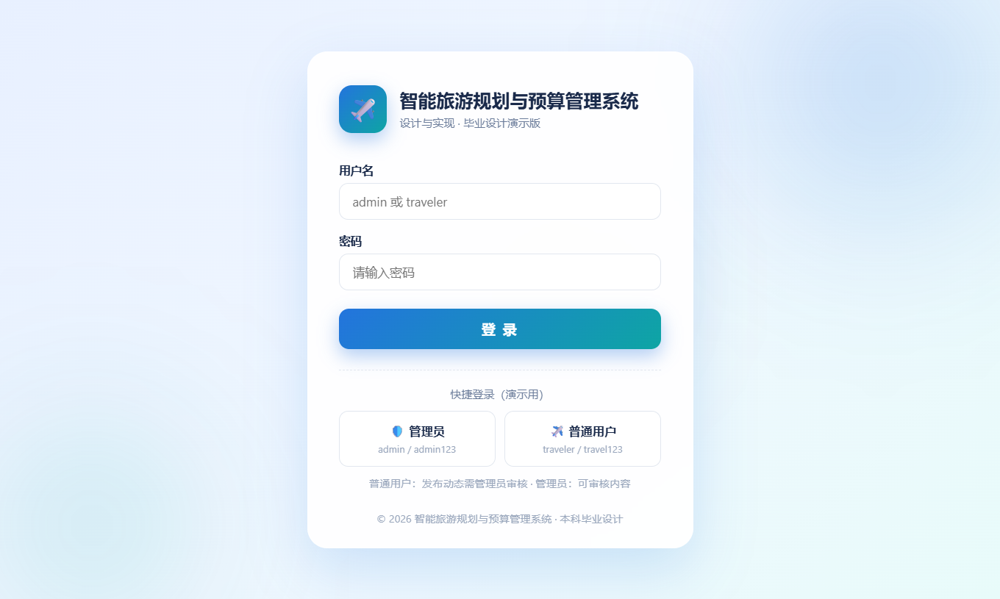
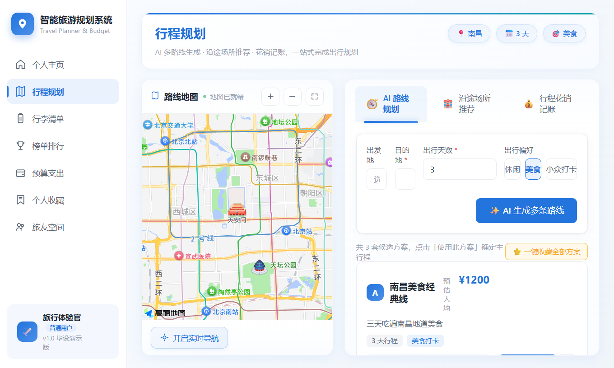
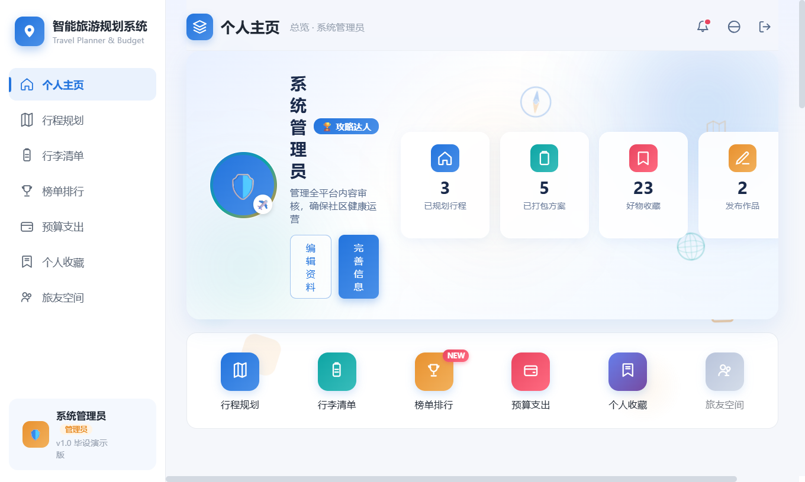
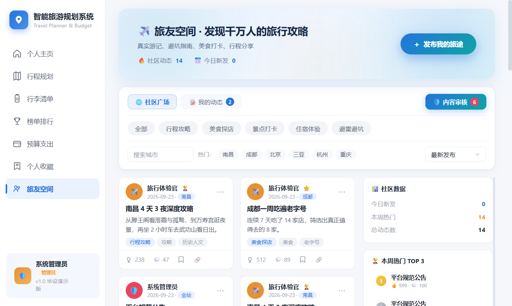
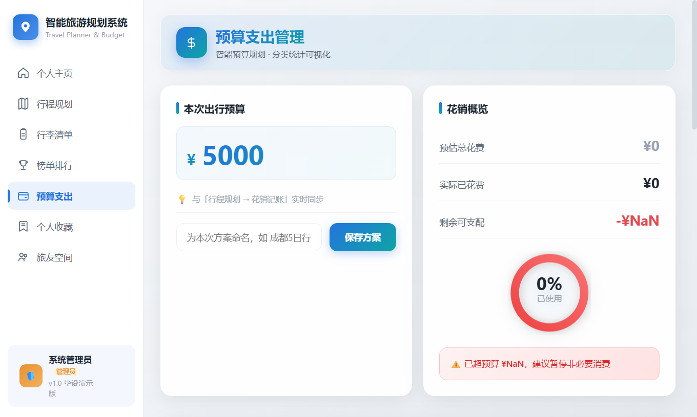
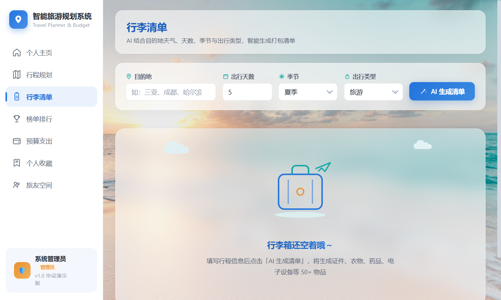
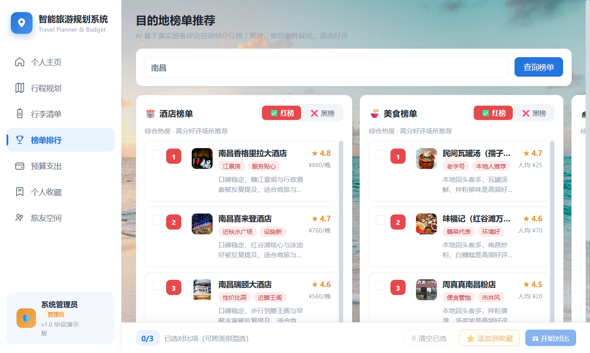
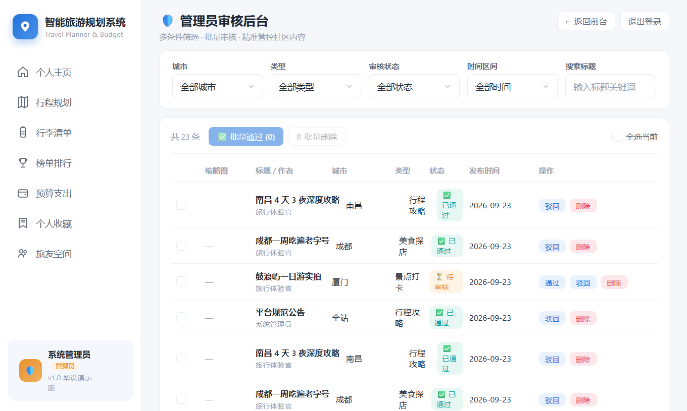
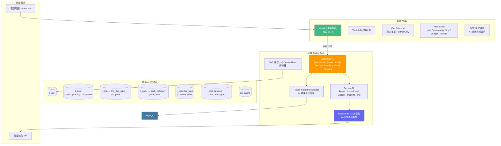

# 🌏 智能旅游规划与预算管理系统


> 基于 **Vue 3 + Spring Boot + DeepSeek-V3** 的全栈智能旅游应用。AI 生成多套完整路线并自动落库，社区旅友空间走管理员审核制，预算可视化 + 行李清单校验 + AI POI 推荐 + SSE 流式问答。

---

## 📌 项目仓库

| 平台 | 地址 | 用途 |
|------|------|------|
| **Gitee（国内）** | https://gitee.com/hyl030514/smart-travel-plan-budget | 国内推荐，克隆/下载速度快 |
| **GitHub** | https://github.com/hyl0514/- | 代码镜像 |

---

## ✨ 核心特性

| # | 特性 | 说明 |
|---|------|------|
| 🧠 | **DeepSeek AI 全链路** | 路线生成、行李清单、预算建议、POI 推荐、旅游问答 —— 统一调用硅基流动的 DeepSeek-V3 |
| 💾 | **AI 结果自动落库** | 生成即按用户归属写入 MySQL（trips / chat_messages / packs / expense_plans / poi_cache），返回 tripId 直接可用 |
| 🔐 | **JWT 鉴权 + 双角色** | 管理员发布即通过，普通用户发布进入审核队列；路由守卫 `adminOnly` 管控后台入口 |
| 🗺️ | **高德地图预留** | AMap JS API 2.0 按环境变量按需注入，支持路线展示、POI 搜索、实时定位；Key 无效时自动降级 |
| 💰 | **预算可视化** | 圆形进度环 + 分类统计 + 账单 CRUD + 历史预算方案 + AI 预算建议 |
| 🎒 | **AI 行李清单** | 按目的地/天数/出行方式生成，AI 校验缺失，标记已准备，分类汇总 |
| 💬 | **SSE 流式问答** | sessionKey 自动归组对话，每轮 user + assistant 消息完整落库 |
| 👥 | **社区旅友空间** | 两列瀑布流 · 骨架屏 · 点赞收藏 · 管理员审核 · 待审核角标提示 |
| 🛡️ | **管理员审核后台** | 多条件筛选 + 批量通过/驳回 + 单条审核详情 + 精准内容管控 |
| 🏆 | **城市榜单** | 黑榜（避雷）/ 红榜（好评）/ 特色榜单，按城市切换，真实实拍图 |

---

## 🖥️ 功能演示（真实截图）

### ① 登录页


一键演示账号：
- 🛡️ **管理员**：`admin / admin123`（发布即通过、可审核）
- ✈️ **普通用户**：`traveler / travel123`（发布需审核）

### ② 个人中心


个人资料 · 旅行统计（行程数/收藏数/预算使用）· 快捷入口导航。

### ③ 行程规划（AI 生成 + 自动保存）


输入目的地、天数、偏好，AI 一次生成 2~3 套完整多日路线（每套都真实落库返回 tripId）。

### ④ AI 智能问答（SSE 流式）


按 `sessionKey` 自动归组对话，每轮 user + assistant 消息完整写入 `chat_sessions / chat_messages`。

### ⑤ 旅友空间（社区）


- 广场：所有已审核通过的公开动态
- 我的动态：自己的全部帖子（含待审核/已驳回）
- 管理员入口：带待审核角标，一键进审核后台

### ⑥ 预算支出


预算设置 → 花销概览（渐变进度环）→ 分类统计 → 账单 CRUD → 历史预算方案 → AI 预算建议。

### ⑦ 行李清单（AI 生成 + AI 校验）


按目的地/天数/出行方式生成，AI 检查缺失，标记已准备，分类汇总。

### ⑧ 榜单排行


黑榜（避雷）/ 红榜（好评）/ 特色榜单，按城市切换，每张卡片配有真实实拍图。

### ⑨ 管理员审核后台


多条件筛选（城市/类型/状态/时间/关键词）、批量通过/删除、单条审核详情。

### 🔟 地图定位（实时）

地图页面打开即自动定位，三层降级策略：

```
① 浏览器 GPS / WiFi 高精度定位（10~50 米，需点「允许」）
  ↓ 未开启权限
② 后端 ipinfo.io 查询真实公网 IP（城市级别，零权限）  ← 默认
  ↓ 服务不可用
③ 保持默认地图视图
```

**真实定位示例**（当前仓库作者机器）：

| 来源 | IP | 城市 | 坐标 |
|---|---|---|---|
| ipinfo.io | `223.104.61.12` | 🇨🇳 广东东莞 | 113.7487, 23.0180 |

### 1️⃣1️⃣ 真实场景测试：3 天南昌旅游规划

用 `traveler / travel123` 登录 → 行程规划 → 输入"南昌 3 天 美食" → AI 一次返回 **3 套完整路线**：

| 方案 | 预估花费 | 摘要 |
|---|---|---|
| 🎯 南昌美食经典线 | ¥1,200 | 三天吃遍南昌地道美食 |
| 🍜 南昌深度美食线 | ¥1,500 | 寻觅南昌隐藏美食 |
| 🏛️ 南昌美食+文化线 | ¥1,800 | 品美食同时感受南昌文化 |

**AI 生成的真实行程片段**（方案 3 示例）：

| Day | 景点 | 坐标（POI 搜索兜底） |
|---|---|---|
| 1 | 八一起义纪念馆 → 老闵田螺馆 → 滕王阁 | 115.8901, 28.6754 |
| 2 | 万寿宫历史文化街区 → 万寿宫小吃街 → 南昌之星摩天轮 | 115.8663, 28.6746 |
| 3 | 柴米油盐(红谷滩店) → 绿地缤纷城 → 老三样(船山路店) | 115.8491, 28.6931 |

**数据库落库验证**（MySQL `travel_h5`）：

```sql
trips           → 3 条新路线（user_id=1，每套带完整 summary + tags）
trip_day_plans  → 9 天行程（3 套 × 3 天）
trip_points     → 30 个点位（每个点位真实坐标）
```

### 1️⃣2️⃣ POI 地理编码容错

AI 生成的点位名可能是小餐馆（如"黄记煌三汁焖锅"），高德标准地理编码 `/v3/geocode/geo` 查不到 → 自动降级到 **POI 文本搜索** `/v3/place/text`：

| 输入 | 标准 geo 编码 | POI text 兜底 |
|---|---|---|
| 「黄记煌三汁焖锅(中山路店)」 | ❌ `ENGINE_RESPONSE_DATA_ERROR` | ✅ `poi-fallback` → 115.849055, 28.693139 |
| 「八一起义纪念馆」 | ✅ 直接命中 | 不需要兜底 |
| 虚构名称（查不到） | ❌ | 返回空 `source=empty`（200 OK，不崩前端） |

前端收到 `null` 时静默跳过该点位，其他点位正常渲染 —— **永不崩溃**。

### 🔑 外部 API Key 配置

项目用到两套外部 Key，分别在前端和后端配置：

| Key | 配在哪里 | 类型 | 申请链接 |
|---|---|---|---|
| 🗺️ 高德 Web 端(JS API) | `travel-h5-java/.env.local` | `VITE_AMAP_KEY` + `VITE_AMAP_SECURITY_CODE` | https://console.amap.com/dev/key/app → 应用类型选 **Web端(JS API)** |
| 🗺️ 高德 Web 服务 | `travel-java-server/src/main/resources/application.yml` | `amap.web-service-key` | https://console.amap.com/dev/key/app → 同一应用下**再添加一个** Key，类型选 **Web 服务** |
| 🧠 硅基流动 DeepSeek V3 | `application.yml` | `llm.api-key` | https://cloud.siliconflow.cn/ → 创建 API 密钥 |

> **重要**：高德 2021 年 12 月后创建的 Web 端 Key 必须同时配安全密钥；两种 Key 不通用（JS API Key 不能调 REST API，反之亦然）。

---

## 🏗️ 系统架构



### AI 生成 → 自动落库（完整数据流）

```
用户点击「生成路线」
    ↓
前端 POST /api/travel/routes/generate（带 Bearer Token）
    ↓
RoutePlanController 注入 @CurrentUser LoginUser(userId)
    ↓
RoutePlanService → LLMutils.chat(prompt) → DeepSeek-V3 返回 JSON
    ↓
TravelPersistenceService.saveRoutePlans(userId, req, vo)
    ├── 每一套路线 → INSERT trips
    ├── 每天行程   → INSERT trip_day_plans
    └── 每个景点   → INSERT trip_points
    ↓
返回 MultiRouteVO（每套路线带 tripId）
    ↓
前端 routeList[i].tripId 可直接用于后续"保存/查看详情"
```

SSE 对话、预算建议、行李清单、POI 推荐同理，均在 AI 返回后立即按用户归属落库。

---

## 🛠️ 技术栈

| 层 | 技术 | 版本 |
|----|------|------|
| 前端框架 | Vue 3 + `<script setup>` + Composition API | 3.x |
| 前端构建 | Vite | 8.x |
| UI 组件 | Vant 4 | 4.x |
| 状态管理 | Pinia | 2.x |
| 路由 | Vue Router | 4.x |
| HTTP | Axios + 拦截器（JWT 自动注入） | 1.x |
| 地图 | 高德地图 JS API 2.0（按需注入，Key 可降级） | 2.0 |
| 后端框架 | Spring Boot | 4.0.6 |
| ORM | MyBatis-Plus | 3.5.7 |
| 鉴权 | JWT（jjwt）+ 拦截器 + @CurrentUser 参数解析器 | - |
| 大模型 | DeepSeek-V3（经硅基流动中转） | deepseek-ai/DeepSeek-V3 |
| 数据库 | MySQL | 8.0+ |
| JSON | Jackson | 2.x |
| 其他 | Lombok、HikariCP 连接池 | - |

---

## 🚀 快速启动

### 环境要求

- JDK **17+**
- Node.js **18+**
- MySQL **8.0+**（账号需有 CREATE / INSERT / UPDATE 权限）
- Maven（或使用项目内 `./mvnw`）

### 步骤 1：克隆仓库

```bash
# 国内推荐（Gitee）
git clone https://gitee.com/hyl030514/smart-travel-plan-budget.git

# GitHub
git clone https://github.com/hyl0514/smart-travel-plan-budget.git

cd smart-travel-plan-budget
```

### 步骤 2：初始化数据库

```bash
mysql -uroot -p < travel_h5_schema.sql
```

脚本自动创建 `travel_h5` 数据库、14 张表、种子账号与种子数据。

**演示账号：**

| 用户名 | 密码 | 角色 | 权限 |
|--------|------|------|------|
| admin | admin123 | 管理员 | 发布即通过 · 审核他人内容 · 管理后台 |
| traveler | travel123 | 普通用户 | 发布需审核 · 浏览 · 收藏 · AI 全部功能 |

### 步骤 3：配置并启动后端（端口 3200）

编辑 `travel-java-server/src/main/resources/application.yml`：

```yaml
spring:
  datasource:
    url: jdbc:mysql://localhost:3306/travel_h5?useSSL=false&allowPublicKeyRetrieval=true&serverTimezone=Asia/Shanghai
    username: root
    password: 你的MySQL密码

llm:
  api-key: sk-xxxxx                          # 硅基流动 API Key（必需，https://cloud.siliconflow.cn）
  base-url: https://api.siliconflow.cn/v1
  model: deepseek-ai/DeepSeek-V3

jwt:
  secret: 你的JWT密钥（任意长字符串）
```

启动：

```bash
cd travel-java-server
./mvnw -DskipTests spring-boot:run
```

### 步骤 4：配置并启动前端（端口 5173）

```bash
cd travel-h5-java
copy .env.example .env.local
# 可选：编辑 .env.local 填入高德 Key（不填也能跑，地图区域降级为友好提示）
npm install
npm run dev
```

访问 http://localhost:5173 即可。前端通过 Vite 代理 `/api → http://localhost:3200` 与后端通信。

> **高德 Key 获取**：https://console.amap.com/ → 控制台 → 我的应用 → 创建应用（Web端）→ 获取 Key + 安全密钥。

---

## 📦 项目结构

```
smart-travel-plan-budget/
├── travel-h5-java/                       # 前端（Vue 3 + Vite）
│   ├── src/
│   │   ├── api/index.js                 # 统一 API 层
│   │   ├── components/
│   │   │   ├── community/               # 社区组件（Card / Filter / Sidebar / Hero / PublishModal）
│   │   │   └── planner/                 # 行程规划组件（RouteTab / MapPanel / PointCard）
│   │   ├── store/                        # Pinia Store（auth / community / trip / budget / favorite）
│   │   ├── utils/                        # API 封装 + Axios + 高德（routeApi / poiApi / budgetApi / packingApi / amapApi / request）
│   │   ├── views/                        # 11 个页面（Login / ProfileHome / TripPlanner / Chat / CommunitySpace / Budget / PackingList / Ranking / AdminReview ...）
│   │   └── router/index.js               # 路由 + 守卫（adminOnly / authOnly）
│   ├── .env.example                      # 环境变量模板
│   ├── vite.config.js                    # Vite 配置（代理 / 端口 / 别名）
│   └── package.json
│
├── travel-java-server/                   # 后端（Spring Boot + MyBatis-Plus）
│   └── src/main/java/org/example/traveljavaserver/
│       ├── controller/                   # 10 个 REST 控制器
│       ├── service/                      # 业务服务 + TravelPersistenceService（AI 落库）
│       ├── entity/                       # 14 张表的数据库实体
│       ├── mapper/                       # MyBatis-Plus Mapper
│       ├── dto/                          # 请求 DTO
│       ├── vo/                           # 响应 VO（含 SSE 流式 VO）
│       ├── auth/                         # JWT 鉴权三件套
│       ├── config/                       # WebConfig / CorsConfig / MybatisPlusConfig
│       └── utils/                        # LLMutils（DeepSeek 调用）/ JsonExtractUtil / JwtUtil
│
├── travel_h5_schema.sql                  # MySQL 初始化（14 表 + 种子 + DDL 注释）
├── rank_seeds.sql                        # 榜单种子数据
├── seed_data.sql                         # 补充种子数据
├── docs/screenshots/                     # README 配图（10 张真实截图）
├── README.md
└── .gitignore
```

---

## 🗄️ 数据库设计（14 张表）

### 用户 & 鉴权
- `t_user` — 用户（username unique, password MD5, role admin/user, status 1=正常）

### 社区旅友空间（审核制）
- `t_post` — 帖子（author_id, status pending/approved/rejected, images JSON, perm public/private）
- `t_comment` — 评论
- `t_favorite` — 收藏

### AI 自动落库（生成即保存）
- `chat_session` — AI 对话会话（user_id, session_key unique, title）
- `chat_message` — AI 对话消息（session_id, role user/assistant, content TEXT）
- `poi_cache` — POI 推荐缓存（payload JSON）
- `t_trip` → `trip_day_plan` → `trip_point` — 行程三级结构
- `t_pack` → `pack_category` → `pack_item` — 行李三级结构
- `t_expense_plan` — 预算方案（source ai/manual, ai_result JSON）

### 榜单
- `rank_item` — 榜单条目（type black/red/featured, city, score）

> 完整 DDL + 字段注释 + 外键约束见 [travel_h5_schema.sql](travel_h5_schema.sql)。

---

## 🔌 API 接口约定

统一响应格式：`{ "success": true, "code": 200, "message": "ok", "data": { ... } }`

鉴权方式：请求头带 `Authorization: Bearer <token>`。

| 模块 | 方法 | 路径 | 说明 | 鉴权 |
|------|------|------|------|------|
| 认证 | POST | `/api/auth/login` | 登录，返回 token + 用户信息 | ❌ |
| 认证 | POST | `/api/auth/register` | 注册 | ❌ |
| 用户 | GET | `/api/auth/me` | 当前用户资料 | ✅ |
| 帖子 | GET | `/api/posts?status=approved` | 列表 | ✅ |
| 帖子 | POST | `/api/posts` | 发布（普通用户 → pending） | ✅ |
| 帖子 | PUT | `/api/posts/{id}/approve` | 审核通过 | ✅ 管理员 |
| 帖子 | PUT | `/api/posts/{id}/reject` | 审核驳回 | ✅ 管理员 |
| 帖子 | DELETE | `/api/posts/{id}` | 删除（作者/管理员） | ✅ |
| 帖子 | POST | `/api/posts/{id}/like` | 点赞/取消 | ✅ |
| **路线** | POST | `/api/travel/routes/generate` | AI 多套路线（自动落库） | ✅ |
| **对话** | POST | `/api/travel/chat` | SSE 流式问答（自动落库） | ✅ |
| 对话 | GET | `/api/travel/sessions` | 当前用户的对话列表 | ✅ |
| **预算** | POST | `/api/travel/budget/advice` | AI 预算建议（自动落库） | ✅ |
| **行李** | POST | `/api/travel/packing/generate` | AI 行李清单（自动落库） | ✅ |
| **POI** | POST | `/api/travel/poi/recommend` | AI POI 推荐（自动落库） | ✅ |
| 行程 | GET | `/api/trips` | 我的行程列表 | ✅ |
| 榜单 | GET | `/api/ranks?city=南昌&type=black` | 榜单 | ✅ |

---

## 🛡️ 权限模型

```
游客（未登录）
├── 能：浏览广场 / 榜单 / 预算 / 行李 / AI 功能（演示）
└── 不能：发布 / 点赞收藏 —— 点发布自动跳登录

普通用户（traveler）
├── 发布动态 → status=pending（仅本人和管理员可见）
├── 审核通过后 → status=approved（全站可见）
└── 只能删除自己的帖子

管理员（admin）
├── 发布动态 → 直接 status=approved
├── 审核后台：多条件筛选 + 批量通过/驳回
├── 社区广场可看全部状态（pending/approved/rejected）
└── 可删除任何帖子
```

前端路由守卫：`meta.adminOnly` → 非管理员访问 `/admin` 自动跳回社区并 toast 提示。
后端接口层：`JwtAuthInterceptor` 拦截所有 `/api/**`（白名单 `/api/auth/login` 等），`LoginUserArgumentResolver` 把 token 中的 userId 自动注入 Controller 的 `@CurrentUser` 参数。

---

## 📈 降级 & 容错

| 场景 | 处理方式 |
|------|----------|
| 后端未启动 | 前端自动降级为纯 localStorage 模式，所有 AI 调用返回模拟数据 |
| AI 服务不可用 | `TravelService` catch 异常后返回 `success=false`，前端 toast 提示 |
| 高德 Key 未配置 | `amapApi.js` 检测 Key 为空时展示"高德地图未启用"友好提示，不阻塞其他功能 |
| 帖子图片加载失败 | `CommunityCard` 兜底 SVG 占位，不显示裂图 |
| 网络断开 | Axios 响应拦截器 catch → toast 提示，不阻塞本地操作 |

---

## 🗺️ 扩展 AI 能力（3 步模板）

如需新增 AI 能力，只需：

1. **Service** 中调用 `LLMutils.chat(systemPrompt, userPrompt)` 获取回复
2. **解析 JSON**（复用 `JsonExtractUtil.extractJson` 处理代码块包裹场景）
3. **持久化**（注入 `TravelPersistenceService`，新增一个 `saveXxx(userId, req, vo)` 方法）

然后 Controller 注入 `@CurrentUser LoginUser`，加一个 `@PostMapping` 端点即可。前端对接：`src/api/index.js` 声明接口 + Store 消费。

---

## 📝 License

MIT License. 自由使用、修改、分发。

---

⭐ 如果这个项目帮到了你，请点个 Star 支持一下！
